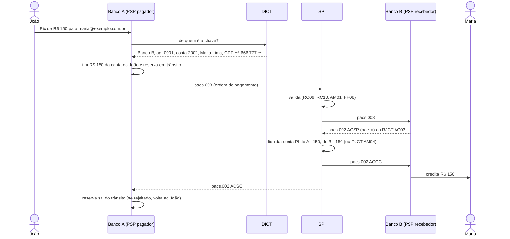

# spi-lab

Simulador de estudo do Pix: participantes, chaves, ordens de pagamento em ISO 20022 e liquidação nas contas de cada participante, montados numa máquina só.

**v0.1:** o Pix por chave funciona de ponta a ponta, com as mensagens do catálogo do SPI validadas contra os XSDs oficiais do Banco Central.

## Por quê

Quem trabalha com Pix costuma ver só um pedaço do fluxo: o PSP de um lado e o SPI como caixa-preta do outro. O spi-lab monta o caminho inteiro, do pagador ao recebedor, para estudar e mostrar como uma ordem de pagamento sai de um participante, passa pelo SPI e é liquidada.

Tudo aqui é feito a partir da **documentação pública do Banco Central**. É um projeto de estudo, não um sistema de produção, e não tem relação com nenhum participante real do arranjo.

## Rodar

Precisa de Docker (e Bash para o script).

```bash
docker compose up -d --build   # PostgreSQL + aplicação em http://localhost:8080
bash scripts/demo.sh           # dois bancos, dois clientes, uma chave e um Pix
```

Saída do script:

```
João manda R$ 150,00 para maria.280487462@exemplo.com.br...
Status: LIQUIDADO (EndToEndId E19748880202610292059w8jUt3PdLPu)

João:  R$ 350,00    Maria: R$ 150,00
Conta PI do Banco A: R$ 999850,00    Conta PI do Banco B: R$ 1000150,00

Mensagens ISO 20022 trocadas:
  pacs.008.spi.1.16  Banco A -> SPI  (ordem de pagamento)
  pacs.008.spi.1.16  SPI -> Banco B  (ordem de pagamento)
  pacs.002.spi.1.18  Banco B -> SPI  ACSP
  pacs.002.spi.1.18  SPI -> Banco B  ACCC
  pacs.002.spi.1.18  SPI -> Banco A  ACSC
```

A API fica documentada em http://localhost:8080/swagger-ui, e `GET /psps/{ispb}/pix/{endToEndId}` devolve o status e o XML de cada mensagem trocada.

## Um Pix, passo a passo



Rejeições cobertas, com os códigos do catálogo:

| Caso | Quem barra | Resultado |
|---|---|---|
| Chave inexistente | Banco A | erro na hora, nenhuma mensagem sai |
| Cliente sem saldo | Banco A | erro na hora, nenhuma mensagem sai |
| Conta do recebedor inexistente | Banco B | `RJCT` `AC03` |
| Conta PI do pagador sem saldo | SPI | `RJCT` `AM04`, valor volta ao cliente |
| Valor zero | SPI | `RJCT` `AM01` |
| EndToEndId incoerente (ISPB de outro banco, data inválida) | SPI | `RJCT` `FF08` |
| Participante desconhecido | SPI | `RJCT` `RC09` / `RC10` |

## Como o dinheiro é registrado

Cada livro (o SPI e cada PSP) tem suas contas num razão em partidas dobradas: toda transação movimenta duas ou mais contas do mesmo livro e a soma das partidas é sempre zero.

- **SPI:** uma conta PI por participante e a conta `STR` (reservas bancárias), de onde vêm os aportes.
- **PSP:** uma conta por cliente, `CAIXA` (origem dos depósitos), `PIX-TRANSITO` (Pix enviados esperando o SPI) e `SPI` (contrapartida do que foi liquidado).

Contas que são dinheiro de alguém (PI, cliente, trânsito) nunca ficam negativas: se uma partida deixaria saldo negativo, a transação inteira é desfeita. Cada lançamento trava as contas envolvidas sempre na mesma ordem, então Pix simultâneos esperam a vez em vez de gastar o mesmo dinheiro. Um teste dispara 50 Pix ao mesmo tempo de um cliente com saldo para 30: exatamente 30 liquidam, 20 são recusados e os três livros fecham em zero.

## DICT

Chaves de CPF, CNPJ (já no formato alfanumérico), e-mail (até 77 caracteres), celular (`+` E.164) e aleatória (UUID gerado pelo DICT), conforme o Manual Operacional do DICT 8.5. Chave de CPF ou CNPJ só do próprio titular; até 5 chaves por conta de CPF e 20 por conta de CNPJ. A consulta devolve o CPF do titular mascarado.

## Mensagens ISO 20022

`pacs.008` e `pacs.002` são montadas e lidas no formato do catálogo do SPI 5.13.2 e conferidas contra os XSDs oficiais (`src/main/resources/bcb/`) na saída e na entrada. Os exemplos oficiais do Banco Central fazem parte dos testes.

## Simplificações da v0.1

- **Tudo síncrono:** a resposta ao banco pagador só sai depois da liquidação. No Pix real a troca é assíncrona, com prazos (40 segundos por transação, pelo Manual de Tempos).
- **Sem idempotência nem timeout:** reenviar a mesma EndToEndId dá erro 409; se a rede cair no meio, o Pix fica em andamento com o valor reservado.
- **Sem assinatura digital:** o XSD exige `AppHdr/Sgntr`; o validador trata só esse campo como opcional.
- **Mensagem fora do XSD volta como HTTP 400:** o SPI real responde com `admi.002`.
- **Um processo só:** SPI, PSPs e DICT conversam por HTTP com XML, mas rodam na mesma aplicação e no mesmo banco de dados.
- **Subconjunto dos campos:** só o necessário para Pix por chave entre contas; QR Code, Pix Saque/Troco, agendamento, MED e devolução (`pacs.004`) ficam de fora.

Escopo, regras, critérios de aceite e decisões (com o porquê de cada uma) em [`docs/spec-v0.1.md`](docs/spec-v0.1.md), conferidos com o catálogo de mensagens do SPI 5.13.2 e os manuais do Banco Central.

## Desenvolvimento

Precisa de Java 21+ e Docker.

```bash
./mvnw verify                   # 40 testes, com PostgreSQL próprio via Testcontainers
docker compose up -d postgres   # só o banco
./mvnw spring-boot:run          # aplicação local, fora do Docker
```

No IntelliJ: abra a pasta do projeto (ele reconhece o `pom.xml`), rode `SpiLabApplication` com o banco do Compose no ar e use `http/demo.http`, que tem o mesmo Pix do script, um passo por clique.

No Windows, nomes com acento no `curl` da linha de comando podem chegar fora de UTF-8; mande o corpo de um arquivo (`--data-binary @corpo.json`), como faz o `scripts/demo.sh`.

## Roteiro

| Versão | Entrega |
|---|---|
| v0.1 | Pix por chave ponta a ponta, mensagens validadas no XSD, partidas dobradas, rejeições do catálogo |
| v0.2 | Idempotência por EndToEndId, fluxo assíncrono com Kafka e outbox, timeouts, devolução (`pacs.004`) |
| v0.3 | Teste de carga com números no README, métricas e painel |

## Stack

Java 21, Spring Boot 4.1, Maven, PostgreSQL 17, Flyway, springdoc-openapi, JUnit 5, Testcontainers, Docker Compose, GitHub Actions.

## Licença

[MIT](LICENSE)
